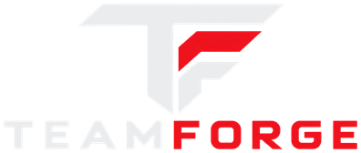
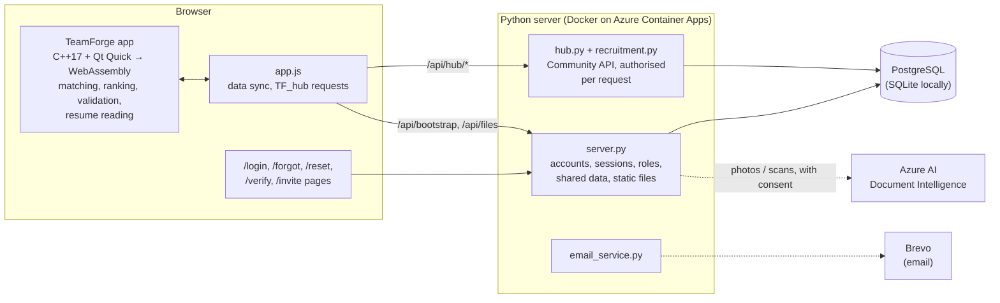
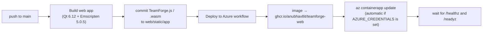

<div align="center">



# TeamForge

**Skill-based team matching for hackathons, PBL projects and academic collaboration.**

Students say what they can do. Projects say what they need. TeamForge ranks who fits,
shows what a team still lacks, and gives people a place to form teams, talk and apply.


**[Open TeamForge](https://teamforge.redfield-82e3be9a.eastasia.azurecontainerapps.io/login)** ·
[Phase 1 report](Phase-1/Report) · [Phase 2 report](Phase-2/PPT-and-Report) · [Phase 3 notes](Phase-3/README.md)

</div>

---

## Contents

- [The problem](#the-problem)
- [What TeamForge does](#what-teamforge-does)
- [How matching works](#how-matching-works)
- [Architecture](#architecture)
- [Tech stack](#tech-stack)
- [Course concepts used](#course-concepts-used)
- [Repository layout](#repository-layout)
- [Getting started](#getting-started)
- [Testing](#testing)
- [Deployment](#deployment)
- [Security and privacy](#security-and-privacy)
- [Known limitations](#known-limitations)
- [Project phases](#project-phases)
- [Team](#team)

---

## The problem

Students usually form hackathon and PBL teams from friends, class WhatsApp groups or Discord.
That is quick, but it often produces a team of four people with the same skills and nobody who
covers a role the project actually needs. Spreadsheets help a little and stop working once there
are hundreds of students and dozens of skills.

TeamForge puts the two sides next to each other: a **student profile** (skills with levels,
skills they want to learn, experience, interests) and a **project's requirements** (skills,
minimum levels, roles, team size). It retrieves candidates, scores and ranks them, and shows
which skills a team covers and which are still missing. The students still make the final
choice; TeamForge makes the comparison structured and easy to check.

## What TeamForge does

TeamForge opens on an entry screen with three workspaces. Which ones an account can open depends
on its role.

| Role | Workspaces |
|---|---|
| Participant | Participant |
| Host | Participant, Host |
| Admin | Participant, Host, Developer, and the Admin page |

### Participant workspace

- **Onboarding in three steps:** name and programme, skills, then levels and learning interests.
- **Resume import:** upload a resume and TeamForge fills the profile for you (see below).
- **Opportunities:** projects and events ranked by how well you fit, with a drawer that explains
  the fit, shows what the team needs, previews the team with you in it, and lets you
  **Express interest** with a short note for the host.
- **My profile:** skills, levels, projects, education, certifications, achievements, photo.
- **Home:** your interest requests, their status and replies from hosts.

### Host workspace

- **Projects:** create and edit projects with required skills, minimum levels and team size.
- **Matching:** ranked candidates for a project, with a **Match insights** drawer showing each
  score factor.
- **Team builder:** build a team and check coverage, gaps, duplicates and size limits before saving.
- **Applicants:** review interest requests, read notes and reply.
- **Participants** and an **Overview** dashboard.

### Developer workspace

For admins and the team, for debugging and demos:
- Browse the participant database (filter by level, sort) and inspect any record: profile,
  skills, learning goals, matching data and the raw JSON.
- Manage the skill catalogue (skills are open-ended; catalogued ones appear in autocomplete).
- Preview the app as any participant, or as the host with a project open.

### Community (real accounts, checked by the server)

| Feature | What it does |
|---|---|
| Teams | Anyone can create a team and lead it. Leaders promote admins, hand over leadership, remove members, edit or delete the team. |
| Team chat | Private to members. Live updates through long polling, unread counts, older messages on request. |
| Team applications | Introduction, skills, experience and reason. Leaders approve or reject, with an optional message. |
| Events | Hosts open a project for applications: positions, places, eligibility, deadline. Extra applicants go on a waitlist. |
| Recruitment | **Find members** searches registered people who are open to invitations, with a compatibility score for each. Leaders send direct invitations or share an **invitation link** (`/invite/<token>`). |
| Skill coverage | Each team's required skills shown as covered, partly covered or missing. |
| Anonymous requests | Message a team, event organiser or person without revealing who you are. The recipient can reply, invite you to apply, report or block. |
| Notifications | Applications, decisions, invitations, messages, role changes, with a bell and unread count. |
| Moderation | Admins review reported anonymous conversations and can block senders. |

### Other features

- **Resume analyser.** Reads PDF, DOCX, ODT, RTF, TXT, Markdown and HTML inside the app, with
  readers written in standard C++ (including a DEFLATE decoder) and no extra libraries. It finds
  the name, known skills, years per skill, projects, education, certifications and achievements,
  and shows each value next to the resume line it came from. Nothing is saved until the person
  reviews it. Years of experience suggest a level (0–1 Beginner … >5 Expert).
- **Photos and scans of resumes.** Checked for blur, darkness and size in C++ first. Then,
  only after the person agrees, the server sends them to Azure AI Document Intelligence to read
  the text. Low-confidence results are refused.
- **One identity per person.** The same name, photo and colour appear everywhere: home, sidebar,
  Community, chat, applications and host lists. Photos are cropped in the app and stored small (≤ 80 KB).
- **Account emails.** Email confirmation, password reset, decisions and invitations, through
  Brevo. Emails are only sent once the provider is configured.
- **Motivational quotes.** 66 ten-word quotes chosen by deterministic rules from the skills you
  entered, drawn as an animated 3D card in plain Qt Quick. They respect reduced-motion settings.
- **Phone layout.** Below 760 px the app switches to a phone layout with a menu drawer and bottom
  tabs. Tested at 320, 390 and 430 px. Host and Developer keep a desktop width and scroll sideways.

## How matching works

Matching runs in the C++ core (in the browser too, through WebAssembly). No language model is
involved: the same data always gives the same score, and every factor is shown to the user.

Each factor is a number from 0 to 1, and the score is their weighted sum (also 0 to 1).
"Covers" means the student has the skill at or above the required minimum level.

| Factor | Weight | How it is computed |
|---|---|---|
| Coverage | 40% | required skills the student covers ÷ all required skills |
| Complementarity | 25% | of the skills the student covers, the share the team does **not** already cover (filling a gap counts, duplicating doesn't) |
| Experience | 15% | average of level ÷ 5 over the required skills the student has |
| Engagement | 10% | 1 once the student has expressed interest in the project, 0.5 (neutral) before that |
| Diversity | 10% | 1 ÷ (1 + team members who already have the student's main role) |

The weights are validated (each between 0 and 1, summing to 1). Phase 1 had an availability
factor; it was dropped from the product and engagement took its 10%.

`MatchingStrategy` is an abstract class. `WeightedMatchingStrategy` implements the scoring above
and `CoverageOnlyStrategy` is a simpler baseline for comparison. The **Compatibility** report in
Community reuses the same weighted scoring against a team's needs and current members.

Missing information is not treated as inability. A skill that is not listed is shown as
"not shown in the profile". An empty profile gets "not enough information" instead of a low
score. TeamForge does not verify skills, and says so in the app.

## Architecture



The **same Qt/C++ code** builds as a Windows desktop app and as a WebAssembly app. Browser-only
code sits behind `#ifdef Q_OS_WASM` / `if(EMSCRIPTEN)`, so the desktop build behaves as before.

Data lives in two places:

1. **The five JSON documents** (students, requirements, teams, skills, interest requests) are
   stored whole on the server and versioned. If two people change the same file, the second
   upload is refused and that person is asked to reload. Each account also keeps its own
   `session.json`.
2. **Community data** lives in relational tables (`teams`, `team_members`, `team_messages`,
   `team_applications`, `event_settings`, `event_applications`, `team_invitations`,
   `team_invite_links`, `notifications`, `anon_*`, `profile_photos`, …). The server checks every
   request against the signed-in account.

## Tech stack

| Layer | Technology |
|---|---|
| Core logic | C++17, standard library (only `JsonStorage` uses Qt) |
| UI | Qt 6 Quick / QML (desktop: Qt 6.8+, CI: Qt 6.12.0) |
| Browser build | Qt for WebAssembly, Emscripten 5.0.5, embind |
| Server | Python 3.12, standard-library HTTP server, `psycopg` for PostgreSQL |
| Database | PostgreSQL Flexible Server (Azure, B1ms), SQLite for local runs |
| Hosting | Azure Container Apps (scales to zero), image on ghcr.io |
| CI/CD | GitHub Actions: `build-web.yml` (WebAssembly build), `deploy-azure.yml` (image + rollout) |
| OCR (optional) | Azure AI Document Intelligence, `prebuilt-read` |
| Email (optional) | Brevo transactional email |
| Build / tests | CMake 3.22+, Ninja, Qt Test, `ctest`, Python test suites, Node for `app.js` tests |
| Reports | LaTeX (Overleaf) |

## Course concepts used

TeamForge is the PBL project for **TCS-302 (Data Structures)** and **TCS-307 (OOP with C++)**.

**Data structures and algorithms (TCS-302)**

| Structure / algorithm | Where | What it does |
|---|---|---|
| Hash map | `SkillIndex` | Skill → students who have it, for fast candidate lookup |
| AVL tree | `SkillBST` | Balanced, ordered skill catalogue: O(log n) even when skills arrive sorted |
| Graph + BFS | `SkillGraph` | Skills offered by the same students are linked; BFS finds related skills when nobody has a required one |
| Min-heap of size k | `Ranker` | Top-k candidates in O(n log k) without sorting everyone |
| Generic container | `Repository<T>` | Template store for domain records |
| Word trie | `ResumeAnalyzer` (`PhraseTrie`) | Longest match of multi-word skill names ("machine learning") in resume text |
| Huffman decoding | `Inflate` | DEFLATE decoder for DOCX/ZIP and PDF streams |
| Interval merging | `ResumeAnalyzer` | Overlapping jobs count once when adding up years |
| Bounded FIFO queue | `Motivation` | Remembers the last six quotes so they don't repeat |
| Hash map + LCG | `Motivation` | Category → quotes, seeded rotation |
| Ordered chat log | `Hub` | Id-ordered messages for chat paging |

**Object-oriented design (TCS-307)**

- Abstract classes and polymorphism: `MatchingStrategy` → `WeightedMatchingStrategy`,
  `CoverageOnlyStrategy`; `ResumeExtractor` → `RuleBasedResumeExtractor`.
- Encapsulated domain classes: `Student`, `Skill`, `ProjectRequirement`, `Team`, `MatchResult`.
- Templates (`Repository<T>`), scoped enums, and an exception hierarchy in `Errors.h`
  (`TeamForgeError` → `ValidationError`, `NotFoundError`, `DuplicateError`,
  `TeamConstraintError`, `PersistenceError`, `DocumentError`).
- A controller (`TeamForgeController`, exposed to QML as `Backend`) that keeps the UI separate
  from the core logic.

## Repository layout

```
TeamForge/
├── .github/workflows/
│   ├── build-web.yml          builds the WebAssembly app and commits it to web/static/app
│   └── deploy-azure.yml       builds the server image (ghcr.io) and rolls it out to Azure
├── Phase-1/                   proposal report and slides (LaTeX + PDF)
├── Phase-2/                   the application
│   ├── src/core/              C++ core: domain, matching, DSA, resume reading, Community rules
│   ├── src/app/               controller and QML bridge (Backend, Hub singleton)
│   ├── src/web/               browser-only bridge (WebBridge)
│   ├── src/main.cpp
│   ├── ui/                    QML: Main, Theme, components, pages, participant, host,
│   │                          developer, community
│   ├── tests/                 13 Qt Test programs (ctest)
│   ├── data/                  sample data: 560 participants, 8 projects, 549 skills,
│   │                          86 interest requests
│   ├── web/
│   │   ├── server.py          accounts, sessions, data API, static files
│   │   ├── hub.py             Community API
│   │   ├── recruitment.py     find members, invitations, invitation links
│   │   ├── email_service.py, email_templates.py
│   │   ├── static/            login/reset/invite/admin pages, the compiled app
│   │   ├── tests/             server test suites
│   │   ├── tools/             demo data, database copy, precompression, wasm copy
│   │   ├── README-WEB.md      full web build and deployment guide
│   │   └── AZURE-DEPLOY.md    Azure setup, step by step
│   ├── tools/                 sample-data generator and helpers
│   ├── PPT-and-Report/        Phase 2 slides and report
│   ├── CMakeLists.txt, Dockerfile, render.yaml
└── Phase-3/                   Phase 3 feature notes and live-platform status
```

## Getting started

### 1. Use it online

Open **https://teamforge.redfield-82e3be9a.eastasia.azurecontainerapps.io/login** and create an
account. New accounts are participants; an admin can make someone a host.

The app scales to zero when nobody is using it, so the first visit after a quiet period can take
a little while to load.

### 2. Run the web version locally (no Qt needed)

The compiled WebAssembly app is already committed, so you only need **Python 3.9+**.
SQLite is built in.

```powershell
cd Phase-2
$env:ADMIN_EMAILS = "you@example.com"
python web\server.py
```

Open http://localhost:8000 and register with the admin email to see all three workspaces and
the Admin page. Data is kept in `web/teamforge-local.db`; delete it to start over.

Open the site through `http://localhost:8000`. WebAssembly cannot load from a double-clicked
HTML file.

To fill the Community with demo accounts, teams, chat and applications:

```powershell
python web\tools\demo_hub_data.py http://localhost:8000
```

### 3. Build the desktop app

You need Qt 6.8 or later (developed with 6.12.0), CMake 3.22+, Ninja and a C++17 compiler
(MinGW 64-bit or MSVC).

```powershell
cd Phase-2
cmake -S . -B build -G Ninja -DCMAKE_BUILD_TYPE=Debug -DCMAKE_PREFIX_PATH=C:/Qt/6.12.0/mingw_64
cmake --build build
.\build\TeamForge.exe
```

The desktop app copies the sample data into its own data folder on first start. It never
writes to `data/` in the source tree. To regenerate the sample data (fixed seed, same output
every time): `python tools/generate_sample_data.py`.

### 4. Build the WebAssembly app yourself (optional)

You don't have to: GitHub Actions does it on every push to `main`. To build locally you need Qt
6.12.0 with *WebAssembly (single-threaded)* and Emscripten **5.0.5** (the versions must match).
See [`Phase-2/web/README-WEB.md`](Phase-2/web/README-WEB.md#1-build-the-app-for-webassembly-on-your-laptop).

## Testing

**C++ / QML (Qt Test, 13 programs):**

```powershell
cd Phase-2
ctest --test-dir build --output-on-failure
```

| Test | Covers |
|---|---|
| `tst_domain`, `tst_persistence` | domain rules, validation, JSON format |
| `tst_scoring`, `tst_engine`, `tst_dsa` | scoring weights, matching engine, hash map / AVL / graph / top-k |
| `tst_compat` | compatibility reports |
| `tst_motivation` | quote library and selection rules |
| `tst_resume` | document readers, skill extraction, years → level, blur and OCR-confidence checks |
| `tst_hub` | Community rules: statuses, capacity, waitlist, roles |
| `tst_controller` | the controller end to end, including permissions |
| `tst_ui`, `tst_screens` | screens rendered offscreen; `TEAMFORGE_SHOTS` saves screenshots |
| `tst_community` | Community screens against a running demo server (`TEAMFORGE_TEST_SERVER`) |

**Server (Python):**

```powershell
cd Phase-2
python web\tests\test_server.py
python web\tests\test_accounts.py
python web\tests\test_hub.py
python web\tests\test_recruitment.py
python web\tests\test_copy_database.py
node web\tests\test_appjs.mjs
```

These run on SQLite by default. Production uses PostgreSQL, which is stricter, so run them on a
real temporary PostgreSQL before deploying:

```powershell
python -m pip install --user pgserver
python web\tests\run_on_postgres.py
```

## Deployment



**Current hosting:** Azure for Students.
- Azure Container Apps (0–1 replicas, scales to zero).
- Azure Database for PostgreSQL Flexible Server, B1ms, East Asia.
- The image is built from `Phase-2/Dockerfile`: Python 3.12 slim, unprivileged user, app files
  gzipped at build time.

**Health checks:** `/healthz` (server up) and `/readyz` (database answers `SELECT 1`).

**Environment variables**

| Variable | Required | Purpose |
|---|---|---|
| `DATABASE_URL` | yes, in production | PostgreSQL connection string (SQLite is used when unset) |
| `ADMIN_EMAILS` | yes | comma-separated emails that become admins |
| `APP_BASE_URL` | for emails | public site address used to build links in emails |
| `EMAIL_PROVIDER`, `EMAIL_API_KEY`, `EMAIL_FROM`, `EMAIL_FROM_NAME` | optional | Brevo email |
| `AZURE_DOCINTEL_ENDPOINT`, `AZURE_DOCINTEL_KEY` | optional | reading photos and scans |
| `TEAMFORGE_READ_MAX_MB`, `TEAMFORGE_READS_PER_HOUR`, `TEAMFORGE_READS_PER_MINUTE` | optional | OCR limits |

Secrets belong only in the host's secret settings, never in the repository.

Step-by-step guides:
- [`Phase-2/web/AZURE-DEPLOY.md`](Phase-2/web/AZURE-DEPLOY.md) for Azure.
- [`Phase-2/web/README-WEB.md`](Phase-2/web/README-WEB.md) for Render (`render.yaml` Blueprint),
  email and OCR setup.

## Security and privacy

- **Passwords** are stored only as PBKDF2-SHA256 hashes with a random salt. Repeated failed
  sign-ins are slowed down.
- **Sessions** are random tokens in an HttpOnly cookie (Secure on HTTPS), valid for 30 days.
- **Password reset and email confirmation** tokens are random. Only their SHA-256 is stored, they
  expire (30 min / 48 h), and a reset signs the account out everywhere. Answers are the same
  whether or not an email has an account.
- **Community requests are authorised on the server**: membership for chat, leader/admin for
  team decisions, organiser for events.
- **Race conditions are handled in the database.** Decisions run in transactions with
  `WHERE status = <expected>`, so two leaders approving at once give one approval, and an event
  never goes over its places.
- **Anonymous requests** never reveal the sender's name, email or id to the recipient. Tests check this.
- **Invitation links** are 32 random bytes and only their hash is stored. Opening a link never
  adds anyone to a team; it leads to an application the leader decides on.
- **Resumes** are read in memory and never stored. Only the details the person confirms are
  saved. Photos are sent to Azure only after consent; Azure's copy of the result is deleted right
  away, and the server logs neither the picture nor the text.
- **Rate limits** on chat, applications, invitations, links, anonymous messages and OCR.

## Known limitations

These are real limits of the current version:

- **Shared JSON files are checked in the app, not on the server.** For the five JSON documents
  (profiles, projects, teams, interest requests), rules such as "edit only your own profile" run
  in the C++ app. The server only limits which files each role may upload. Someone calling the
  API by hand could bypass the app's rules for those files. Community data does not have this
  problem. Moving those checks to the server is the main open security task.
- **Matching is rule-based**, not machine learning. That keeps it explainable and repeatable, but
  the weights were chosen by the team and have not been tuned on real outcomes.
- **Skills are self-reported.** TeamForge does not verify them.
- **One server process.** Live chat uses long polling and in-memory rate limits, which assumes a
  single instance. More instances would need a shared notifier and shared limits.
- **Host and Developer workspaces are desktop-only in practice.** On phones they scroll sideways.
- **Optional services need setup.** Emails and photo/scan reading do nothing until their
  environment variables are set.

## Project phases

| Phase | What was delivered | Documents |
|---|---|---|
| **Phase 1** | Problem study, goals, approach, system architecture | [Report](Phase-1/Report) · [Slides](Phase-1/PPT) |
| **Phase 2** | The Qt/C++ application: matching engine, data structures, three workspaces, tests, web version | [Report and slides](Phase-2/PPT-and-Report) · [App README](Phase-2/README.md) |
| **Phase 3** | Live platform: quotes, resume analyser (any document, OCR), interest notes, Azure hosting, Community (teams, chat, applications, events, anonymous requests, notifications), recruitment and compatibility, one identity and photos, account emails, phone layout | [Phase 3 notes](Phase-3/README.md) · [Live-platform status](Phase-3/LIVE-PLATFORM-STATUS.md) |

## Team

**Team TEAMFORGE** · Team ID **DSCPP-III-2026-T238**
Graphic Era (Deemed to be University) · B.Tech Semester III · Session 2026–27
Courses: TCS-302 + TCS-307 · Mentor: **Dr. Hriday Kumar Gupta**

| Member | Role |
|---|---|
| Mukul Fartiyal | Team / Integration Lead |
| Anubhav Bisht | UI / Testing / Documentation Lead |
| Siddhant Singh | C++ / OOP Lead |
| Mehul | DSA Lead |

## Credits

- [Qt](https://www.qt.io/) (Qt Quick, Qt for WebAssembly) and [Emscripten](https://emscripten.org/).
- Fonts: Manrope and Noto Sans Mono, both under the SIL Open Font License (licence files are in the repository).
- [psycopg](https://www.psycopg.org/) for PostgreSQL.

This repository does not include a licence file yet, so all rights are reserved by the authors
by default. Add a `LICENSE` file if you want others to reuse the code.
